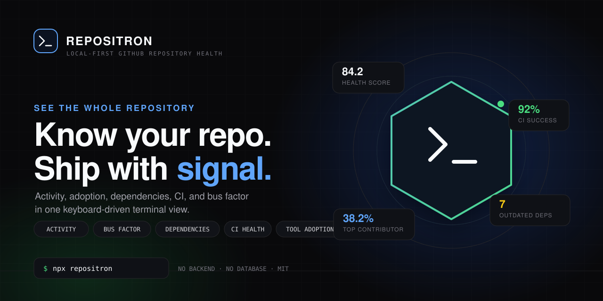
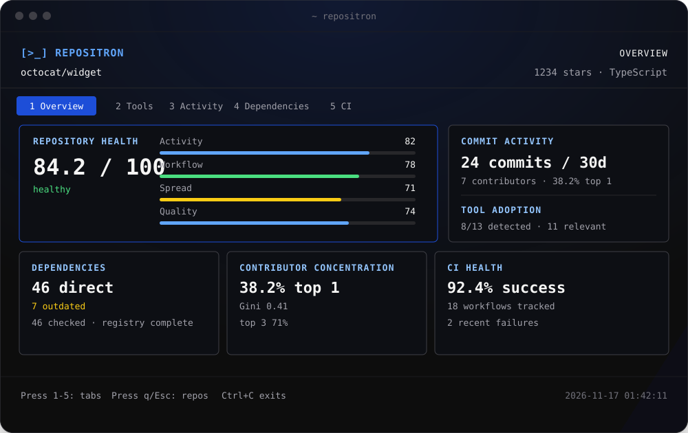

<p align="center">
  
</p>

<p align="center">
  <b>An interactive terminal dashboard for GitHub repository health.</b><br>
  Activity · tool adoption · dependencies · CI · bus factor
</p>

<p align="center">
  <a href="https://github.com/zelvarys/repositron-dt/tree/cli"></a>
  <a href="https://www.npmjs.com/package/repositron"></a>
  <a href="https://github.com/zelvarys/repositron-dt/blob/main/LICENSE"></a>
</p>

## Run it

Requires Node.js 22 or newer.

```sh
npx repositron
```

Repositron signs in with GitHub, lists repositories you own or have contributed
to in the last 12 months, scans one on demand, and opens a keyboard-driven
dashboard. There is no database, hosted backend, or worker to run.



## What it checks

| Area | What you get |
| --- | --- |
| Repository health | One weighted score across activity, CI stability, contributor spread, and commit quality |
| Activity | Commit ranges, weekly rhythm, weekday pulse, contributors, and commit quality |
| Tool adoption | Up to 13 detectors, including test runners, linters, CI, and dependency automation |
| Bus factor | Gini coefficient plus top 1, 3, and 10 contributor shares |
| Dependencies | Direct manifests, latest registry versions, and major-version drift |
| CI | Workflow success rates, run counts, average duration, and recent failures |

Scans are local-first and intentionally bounded. The CLI README documents the
metric definitions, limits, and development workflow.

## Repository layout

`main` holds this overview. The CLI lives on the `cli` branch and is cloned into
a folder of the same name.

| Branch | Contents |
| --- | --- |
| [`main`](https://github.com/zelvarys/repositron-dt/tree/main) | Overview, README assets, license |
| [`cli`](https://github.com/zelvarys/repositron-dt/tree/cli) | The `repositron` npm package, tests, and docs |

```sh
git clone --branch main --single-branch https://github.com/zelvarys/repositron-dt.git repositron
cd repositron
git clone --branch cli --single-branch https://github.com/zelvarys/repositron-dt.git cli
```

<details>
<summary><b>For contributors: build the CLI locally</b></summary>

<br>

```sh
cd cli
npm install
npm run build
node dist/cli.js
```

During development:

```sh
npm run dev
npm test
npm run typecheck
```

See the CLI branch for the full architecture, insight definitions, and testing
notes.

</details>

## License

MIT
